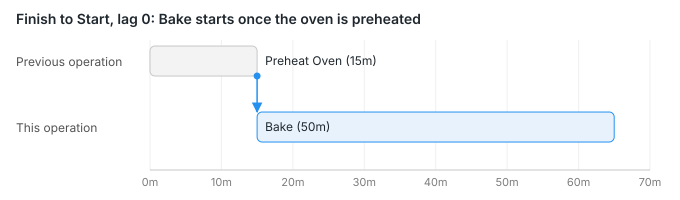
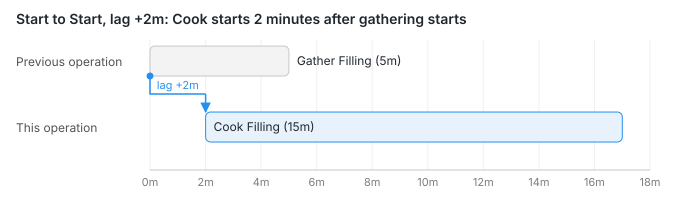
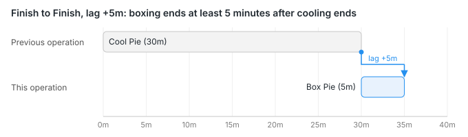
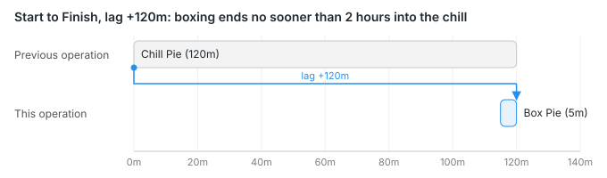
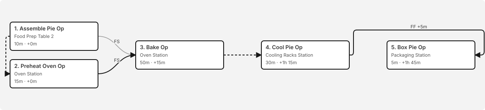
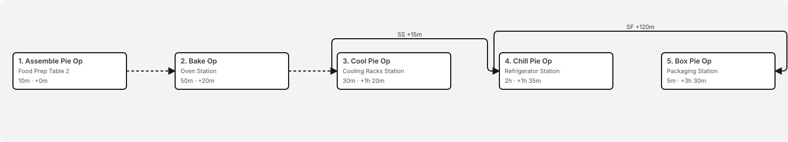

<!-- Copyright (c) 2026, AgriTheory and contributors
For license information, please see license.txt-->

# Operation Relations and the Operation Flowchart

  Tyler Matteson 2026-11-12

## Overview
ERPNext runs the operations of a BOM, Routing, or Work Order one after another. Each operation waits for the previous one to finish, then for the "Time Between Operations" gap in Manufacturing Settings. Real routes are rarely that strict. A filling can start cooking a few minutes after the ingredients start coming off the shelf. A pie can't be boxed until it has cooled.

Operation Relations let each operation say how it depends on the operation before it. Each relation ties the **start** or **finish** of the previous operation to the **start** or **finish** of this one, plus an optional lag in minutes. The four combinations are the standard precedence relations from project scheduling. Read the name as "the previous operation's ___ gates this operation's ___":

| Relation | Short label | Rule | Examples |
|---|---|---|---|
| Finish to Start | FS | This operation starts after the previous one finishes | Bake starts once the oven has finished preheating. A weld is inspected only after welding is done. |
| Start to Start | SS | This operation starts after the previous one starts | Cooking the filling starts 2 minutes after gathering ingredients starts. Inspection starts 15 minutes into a machining run, as the first parts come off. |
| Finish to Finish | FF | This operation finishes after the previous one finishes | Boxing finishes 5 minutes after cooling finishes. Labeling a batch can't finish until printing the labels finishes. |
| Start to Finish | SF | This operation finishes after the previous one starts | Boxing can't finish until the pie has been in the refrigerator for 2 hours. The outgoing shift can't finish until the incoming shift has started. |

In a production-scheduling model these relations are processing constraints on the route of steps that each job follows. Maravelias (2012) classifies ERPNext's Work Orders, operations, and alternative workstations as a flexible job-shop (see [References](#references)).

The **Operation Flowchart** draws the route with these relations and computes when each operation can start.

## Where Relations Are Set
Two fields are added to Operation, BOM Operation (used by both BOM and Routing), and Work Order Operation:

- **Relation to Previous Operation** (`predecessor_relation`): blank, or one of the four relations above
- **Lag (Mins)** (`lag_mins`): shown once a relation is selected. Positive values add a wait; negative values let this operation lead (overlap) the previous one

Values flow down the same way ERPNext copies operations:

1. The **Operation** holds the default. Picking an Operation on a BOM or Routing row copies its relation and lag onto the row.
2. A **BOM** that uses a **Routing** copies the relation and lag from each Routing row.
3. A **Work Order** copies the relation and lag from its BOM's operations.

Each copy can be edited without changing its source.

## Sequence ID and the Default Gap
Relations build on ERPNext's Sequence ID rather than replacing it.

- Operations with the same Sequence ID form a group. A row with a blank relation starts at the same time as the first row in its group.
- Every row is related to every row of the previous group. If the row's relation is blank, it uses Finish to Start plus Manufacturing Settings' "Time Between Operations" (10 minutes when unset). That reproduces ERPNext's behavior exactly.
- If the row has a relation, the relation and its lag replace the default. The "Time Between Operations" gap is not added on top, and lag only applies when a relation is selected.
- The relation on the first operation of a route is ignored because there is no previous operation.

## The Four Relations
In each diagram the gray bar is the previous operation and the blue bar is the operation that carries the relation. The arrow shows which edge is tied to which, and the lag between them. The examples come from the bakery test fixtures.

### Finish to Start (FS)
The successor starts after the predecessor finishes. This is ERPNext's normal behavior, but with an explicit lag instead of the Manufacturing Settings gap. Use it for a strict hand-off: Bake can't start until the oven has preheated, and with a lag of 0 there's no extra wait.

### Start to Start (SS)
The successor starts once the predecessor has started, plus lag, and the two then run side by side. Use it for operations that overlap: cooking the filling can begin two minutes after gathering begins, without waiting for every ingredient.

### Finish to Finish (FF)
The successor can't finish until the predecessor has finished, plus lag. Its start is worked backward from that finish. Use it when the end of one step gates the end of the next: boxing can't finish until five minutes after cooling finishes, but the short boxing step starts just in time rather than right after cooling.

### Start to Finish (SF)
The successor can't finish until the predecessor has *started*, plus lag. It's the least common relation, and the easiest to misread: it says nothing about when the predecessor ends. Use it for a deadline measured from when something else starts. In the Key Lime Pie fixture, boxing can't finish until two hours after the pie goes into the refrigerator, so the pie has set before it's packed.

### Lag
Lag is measured from the predecessor's tied edge (start or finish) to the successor's tied edge, in minutes:

- **Positive lag** adds a wait, for example cooling time after baking.
- **Zero lag** ties the two edges exactly.
- **Negative lag** lets the successor lead. For example, Finish to Start with a lag of -10 starts the successor ten minutes before the predecessor finishes. The flowchart shows a warning on these rows so the overlap is deliberate.

For readers who prefer formulas, with *S* the start time, *p* the duration, and *L* the lag, the earliest start of operation *b* after predecessor *a* is:

| Relation | Constraint |
|---|---|
| Finish to Start | Sb ≥ Sa + pa + L |
| Start to Start | Sb ≥ Sa + L |
| Finish to Finish | Sb + pb ≥ Sa + pa + L |
| Start to Finish | Sb + pb ≥ Sa + L |

When an operation has several predecessors (the previous group has more than one row), it starts at the latest of their bounds. No operation starts before the route's release at time 0.

## Reading the Flowchart
The Operation Flowchart appears below the operations table on BOMs (when "With Operations" is checked), Routings, and Work Orders. It updates as rows are edited, before saving.

The Gooseberry Pie BOM uses the "Preheated Fruit Pie" Routing. Assemble and Preheat Oven share Sequence ID 1, so they start together. Bake waits for both with Finish to Start and no lag. Cool follows with the default gap, and Box finishes five minutes after Cool (Finish to Finish +5).

The Kaduka Key Lime Pie BOM uses Start to Start and Start to Finish. Chill starts 15 minutes after Cool starts. Box can't finish until 120 minutes after Chill starts.

- **Columns** are Sequence ID groups, left to right. Operations in the same column start together unless a relation says otherwise.
- **Each box** shows the row number and operation, the workstation, the duration, and the earliest start measured from the start of the route.
- **Arrows** leave from the predecessor's start (left edge) or finish (right edge) and enter the successor's start or finish the same way. Start to Start and Start to Finish arrows go over the top of the chart from the predecessor's left edge.
- **Dashed arrows** are defaults: Finish to Start with the Manufacturing Settings gap, or a shared start within a group. **Solid, labeled arrows** are explicit relations, labeled with the short code and lag (for example `SS +15m`).
- **Highlighted borders** mark the critical path: the operations that would delay the whole route if they ran longer. Hover a box to see its slack, the minutes it could slip without delaying the finish.
- **Total time** at the top is the earliest finish of the whole route. On a Work Order the finish date and time, counted from the planned start date, is shown too.
- **Clicking an operation** opens its row in the operations table for editing.

### Warnings
A "!" badge on a box means the row has a warning or an error. Every issue is also listed below the chart, and clicking an issue opens the row. The flowchart reports:

- Negative lag, so overlap is a deliberate choice
- A relation on the first operation, which is ignored
- A relation value it doesn't recognize, which is treated as blank (an error)
- Sequence ID problems that ERPNext accepts on a BOM or Routing but rejects on every Work Order made from it: some rows numbered and some blank, a first Sequence ID other than 1, a Sequence ID lower than the row before, or a gap in the numbering

## Limitations
- The flowchart computes timing from relations and durations only. It doesn't account for workstation capacity, working hours, holidays, or other Work Orders competing for the same workstation.
- ERPNext's Work Order operation planning and Job Card scheduling don't use the relations yet. They still plan operations one after another.

## References
Maravelias, C. T. (2012). General framework and modeling approach classification for chemical production scheduling. *AIChE Journal*, 58(6), 1812–1828. [https://doi.org/10.1002/aic.13801](https://doi.org/10.1002/aic.13801)
